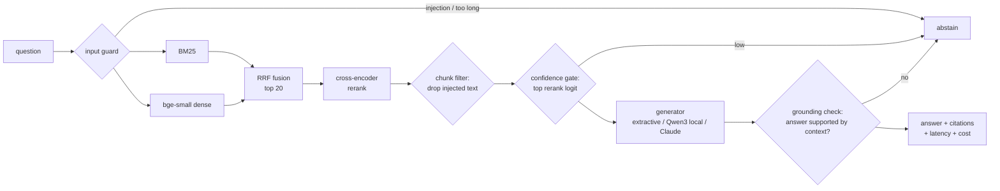

# rag-eval-lab

Retrieval-augmented question answering built around its evaluation harness. Each design choice
(chunking, retriever, reranker, generator, guardrails) is scored on labelled questions, and every
number in this README comes from a run in [`results/`](results/).


## Key findings

| | |
|---|---|
| Best retrieval pipeline | paragraph chunks → BM25 + bge-small hybrid (RRF) → MiniLM cross-encoder: **Recall@1 0.900, Recall@5 0.979, nDCG@10 0.949** |
| Hybrid vs single retriever | hybrid beats both BM25 and dense on 4 of 5 chunkers (Recall@1 +1 to +3 points over BM25, +9 to +15 over dense). On 256-word chunks BM25 alone has the best Recall@1 |
| Reranking | +11 to +13 points Recall@1 on 64 to 130-word chunks, but only **+2** on 256-word chunks (the cross-encoder was trained on short passages) |
| Dense-only retrieval | the weakest option here, because SQuAD questions reuse the passage's wording, which favours lexical matching |
| Abstention | SQuAD 2.0 unanswerable questions are adversarial: the retrieval-confidence gate separates them with AUROC of only 0.63, so the generator has to do the abstaining |
| Metric trap | with half the questions unanswerable, "abstain on everything" scores F1 0.50. Every guardrail setting is reported against that reference row |

## How it works



| Stage | Implementation |
|---|---|
| Chunking | fixed word windows with overlap, sentence packing, native paragraphs ([chunking.py](raglab/chunking.py)). Every chunk keeps exact character offsets |
| Retrieval | BM25 as a precomputed sparse matrix (one sparse matmul per query batch), bi-encoder dense retrieval, reciprocal-rank fusion ([retrievers.py](raglab/retrievers.py)) |
| Reranking | `cross-encoder/ms-marco-MiniLM-L-6-v2` over the top 20; its logit also feeds the confidence gate |
| Generation | extractive no-LLM baseline; local `Qwen/Qwen3-0.6B`; Claude (`claude-opus-5-5`) via the Anthropic SDK with server-side refusal fallbacks ([generators.py](raglab/generators.py)) |
| Guardrails | prompt-injection patterns on the query **and** on retrieved chunks, a retrieval-confidence gate, a post-generation grounding check ([guardrails.py](raglab/guardrails.py)) |
| Caching | SQLite cache for chunk embeddings, cross-encoder scores and LLM responses, keyed by content hash ([cache.py](raglab/cache.py)) |
| Telemetry | per-stage latency (p50/p95), token counts, USD cost per query ([telemetry.py](raglab/telemetry.py)) |
| Serving | FastAPI with `/ask`, `/health`, `/stats` ([api.py](raglab/api.py)), Dockerfile, GitHub Actions CI |

## Evaluation design

**Data.** [SQuAD 2.0](https://rajpurkar.github.io/SQuAD-explorer/) dev set (CC BY-SA 4.0). The 1,204
paragraphs are stitched back into their **35 full Wikipedia articles** (152k words), so the chunker
has real work to do instead of receiving pre-cut passages.

**Labels that work for any chunker.** Gold answers are character spans in the article. A chunk counts
as relevant iff it fully contains a gold span ([data.py](raglab/data.py)). This lets 64-word windows,
sentence packs and paragraphs all be scored against the same 1,000 questions. Each chunker's
"answer coverage" (the share of questions where *some* chunk contains the whole answer) is reported
as an upper bound.

**No tuning on the test set.** Questions are split into tune and test sets **by article** (30/70), so
guardrail thresholds are never chosen on the topics they are scored on. Thresholds are picked on the
tune split, and only the test split is reported.

**Unanswerable questions.** SQuAD 2.0 includes 5,945 questions written to look answerable from the
article but with no answer in it. They measure whether the system abstains instead of hallucinating.
SQuAD 2.0 F1 credits an abstention only when there is no gold answer.

**Metrics.** Retrieval: Recall@k, MRR@10, nDCG@10. Answers: SQuAD EM/F1 overall, F1 on answerable
questions, abstention accuracy on unanswerable ones, answer rate. Diagnostics: context recall, F1
split by whether the gold chunk reached the generator (retrieval error vs reader error), gate AUROC,
latency, tokens and cost.

## Results

### 1. Retrieval grid: 5 chunkers × 5 retrievers, 1,000 test questions

Recall@1 / Recall@5 / nDCG@10 (full table with R@3, R@10, R@20, MRR and timings: [results/retrieval_grid.md](results/retrieval_grid.md)):

| chunker (chunks, avg words) | BM25 | MiniLM-L6 | bge-small | hybrid | hybrid + rerank |
|---|---|---|---|---|---|
| fixed 64w / 16 overlap (3180, 64) | .664 / .885 / .763 | .577 / .843 / .703 | .591 / .863 / .727 | .693 / .933 / .804 | .818 / .961 / .877 |
| fixed 128w / 32 (1591, 127) | .732 / .924 / .827 | .573 / .852 / .718 | .583 / .854 / .723 | .741 / .944 / .843 | .850 / .977 / .908 |
| fixed 256w / 64 (800, 252) | .761 / .936 / .854 | .566 / .835 / .696 | .525 / .839 / .694 | .731 / .941 / .841 | .754 / .935 / .852 |
| sentence-packed 120w, 1-sentence overlap (1873, 105) | .750 / .919 / .838 | .602 / .853 / .735 | .657 / .877 / .770 | .764 / .942 / .858 | .875 / .975 / .924 |
| paragraph (1212, 126) | .781 / .935 / .876 | .641 / .882 / .791 | .685 / .906 / .819 | .792 / .953 / .891 | **.900 / .979 / .949** |

What the grid shows:

* **Boundaries matter more than size.** Sentence-packed and paragraph chunks average about the
  same length as fixed-128 windows yet beat them on Recall@1 and nDCG@10 for every retriever: a window that cuts mid-sentence
  blurs the passage it came from.
* **Bigger chunks help BM25 and hurt dense retrieval.** BM25 Recall@1 rises from .664 to .761 going
  from 64 to 256 words, while bge-small falls from .591 to .525, because one vector has to summarise
  more text.
* **The reranker is the biggest single gain**, except on 256-word chunks, which exceed what the
  MS MARCO cross-encoder was trained on.
* **Caveat:** SQuAD annotators wrote each question while reading one paragraph, which flatters the
  paragraph chunker. The sentence packer is the corpus-agnostic choice and trails it by only 2.5
  points of Recall@1.

### 2. End-to-end with guardrail ablation (400 test questions, half unanswerable)

Pipeline: paragraph chunks → hybrid → rerank → top 3 chunks → generator. Thresholds are chosen on 150 tune-split questions.

**Extractive baseline (no LLM)**: returns the context sentence with the most question words ([results/e2e_extractive.md](results/e2e_extractive.md)):

| setting | EM | F1 | HasAns F1 | NoAns acc | answer rate |
|---|---|---|---|---|---|
| reference: abstain on everything | 0.500 | 0.500 | 0.000 | 1.000 | 0.000 |
| no guardrails | 0.003 | 0.090 | 0.180 | 0.000 | 1.000 |
| confidence gate (threshold passes 50% of tune answerables) | 0.405 | 0.444 | 0.083 | 0.805 | 0.290 |

* **Retrieval is not the bottleneck.** The gold span reaches the generator for 96.0% of answerable
  questions. The baseline's low F1 is a reader problem: it returns whole sentences, while SQuAD
  scores short spans.
* **The confidence gate is weak on adversarial negatives.** The top reranker logit separates
  answerable from unanswerable questions with AUROC 0.629, because the unanswerable questions were
  written to match the article. The tuner picked the setting that abstains most, which still scores
  **below** the abstain-on-everything reference. A retrieval-score gate can't solve SQuAD 2.0
  abstention; the reader has to.
* Online retrieval latency on a laptop CPU: p50 1.3 s / p95 2.7 s, almost all of it the cross-encoder.

**Local LLM (Qwen3-0.6B)**: the CPU run is in progress; results will be added to
`results/e2e_local_Qwen3-0.6B.md`.

## Quickstart

```bash
python -m venv .venv && source .venv/bin/activate      # Windows: .venv\Scripts\activate
pip install -e ".[ml,claude,dev]"
python -m raglab download                               # SQuAD 2.0 dev, 4 MB

python -m raglab eval-retrieval                         # results/retrieval_grid.md
python -m raglab eval-e2e --generator extractive        # results/e2e_extractive.md
python -m raglab eval-e2e --generator local             # Qwen3-0.6B, GPU recommended
ANTHROPIC_API_KEY=... python -m raglab eval-e2e --generator claude

python -m raglab ask "What century did the Normans first gain their separate identity?"
python -m raglab serve                                  # http://127.0.0.1:8000/docs
```

```bash
curl -s localhost:8000/ask -H 'content-type: application/json' \
     -d '{"question": "Who was the duke in the battle of Hastings?"}'
```

The response includes the answer, an abstention reason (`ok`, `low_confidence`, `model_abstained`,
`ungrounded`, `prompt_injection`, ...), citations with character offsets, per-stage latency, token
counts, cost and whether the LLM cache was hit. `/stats` aggregates these over recent requests.

Docker: `docker build -t rag-eval-lab . && docker run -p 8000:8000 rag-eval-lab`.

### Your own documents

Point the config at a folder of `.txt` / `.md` files and an optional question set:

```yaml
corpus: {type: dir, path: my_docs/, questions: my_questions.jsonl}
```

Each line of `my_questions.jsonl` is `{"question": "...", "answers": ["..."]}`; empty `answers` marks
an unanswerable question. Without character spans, a chunk counts as relevant when it contains a
normalised gold answer string.

## Limitations

* **Embedding-model contamination.** `all-MiniLM-L6-v2` was trained on SQuAD question–paragraph
  pairs, and BGE's training mix likely overlaps too. Absolute dense numbers are therefore optimistic.
  Comparisons *across chunkers* for the same model remain fair.
* **One dataset.** SQuAD questions are lexically close to their passages. On conversational or
  paraphrased queries, dense retrieval would gain relative to BM25.
* **CPU latency.** Timings come from a 4-core laptop CPU. The cross-encoder dominates retrieval latency
  (about 1 s for 20 pairs) and would drop roughly tenfold on a GPU or with `top_n: 10`.
* **The grounding check is lexical.** It checks that the answer's content words occur in the
  context. That is cheap and catches invented entities, but not a wrong span copied from the context.

## Layout

```
raglab/
  data.py         corpus + labelled questions, document-level tune/test split
  chunking.py     fixed / sentence / paragraph chunkers with exact offsets
  retrievers.py   BM25, dense, hybrid RRF, cross-encoder reranker
  generators.py   extractive baseline, local HF model, Claude
  guardrails.py   injection filter, confidence gate, grounding check
  pipeline.py     orchestration + per-stage telemetry
  evaluate.py     retrieval grid + end-to-end eval with guardrail ablation
  metrics.py      Recall@k, MRR, nDCG, SQuAD EM/F1, AUROC
  api.py          FastAPI service
configs/          retrieval_grid.yaml, default.yaml
results/          every table in this README, as JSON + Markdown
tests/            27 unit tests (chunk offsets, metrics, retrieval, guardrails, API)
```

## License

MIT. SQuAD 2.0 is CC BY-SA 4.0 and is downloaded at runtime, not redistributed.
